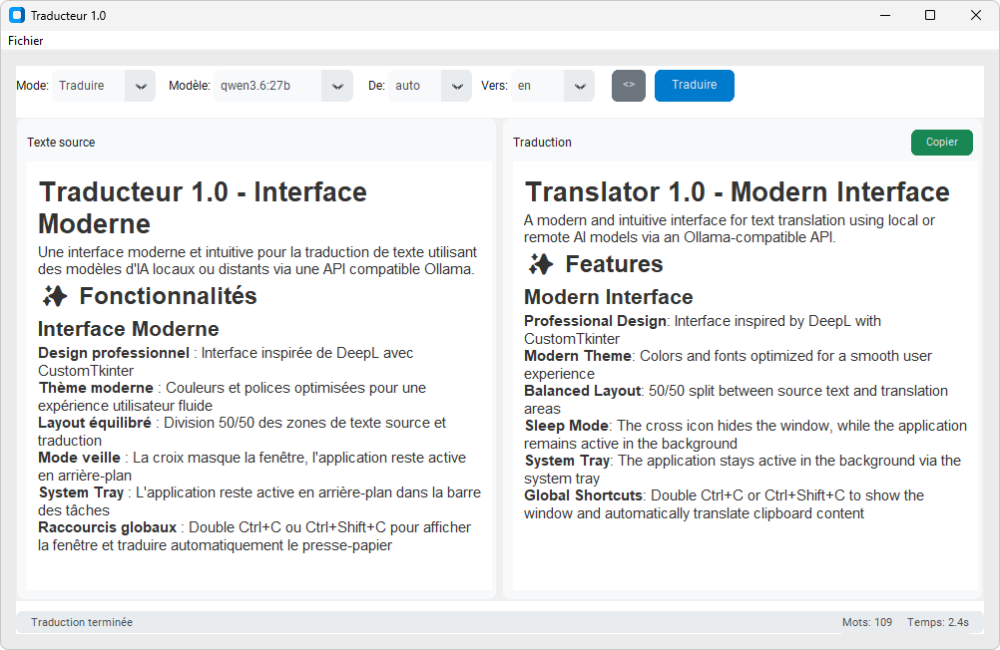

# Traducteur IA (1.1.0)

Traducteur IA 1.1.0 est une application Windows conçue pour traduire et réécrire des textes, ainsi que pour rédiger des courriels, depuis une interface graphique ou directement à partir du presse-papiers. Elle permet de travailler rapidement tout en préservant autant que possible la structure du contenu, notamment les liens, les titres, le gras et l'italique.

L'application s'appuie sur un grand modèle de langage (LLM) accessible par une API Ollama ou OpenAI/vLLM. Selon vos besoins, ce modèle peut être exécuté localement sur votre ordinateur ou hébergé sur un serveur distant.

## 🖼️ Aperçu



## 🤖 Principe de fonctionnement

Cette application fournit l'interface de traduction, mais n'embarque pas elle-même de grand modèle de langage (LLM). Elle envoie le texte au modèle défini dans le fichier de configuration de l'application (`.translator_config.json`) :

- **LLM local** : Ollama et le modèle fonctionnent sur votre ordinateur. Les textes restent sur la machine, mais la vitesse dépend directement du modèle et du matériel. Un petit modèle peut fonctionner uniquement avec le processeur, mais les réponses seront souvent plus lentes. Pour une utilisation fluide, un ordinateur récent avec suffisamment de mémoire et, idéalement, une carte graphique dédiée compatible est recommandé. Plus le modèle est volumineux, plus ses besoins en mémoire et en puissance augmentent.
- **LLM distant** : le modèle fonctionne sur un autre serveur accessible par le réseau. Configurez alors son adresse et, si nécessaire, sa clé API.

Le serveur doit proposer une API Ollama ou une API compatible OpenAI. L'application ne télécharge et ne démarre pas elle-même le modèle. Pour une utilisation locale avec Ollama, consultez le [guide de démarrage officiel](https://docs.ollama.com/quickstart) et la [documentation de l'API Ollama](https://docs.ollama.com/api/introduction).

## 🚀 Installation sous Windows

L'installateur fourni est la méthode recommandée. Python et les dépendances du projet ne sont pas nécessaires.

1. Téléchargez [`dist/traducteur-setup.exe`](dist/traducteur-setup.exe) et lancez-le.
2. Suivez l'assistant et adaptez les choix proposés à votre usage local ou distant.
3. Lancez Traducteur depuis l'assistant, le menu Démarrer ou son raccourci facultatif sur le bureau.

L'assistant se charge de créer le fichier de configuration de l'application (`.translator_config.json`). Il demande d'abord de choisir entre l'environnement EPFL/RCP et un autre serveur. Pour un autre serveur, il propose ensuite Ollama ou OpenAI/vLLM, puis affiche directement les URL exactes correspondantes. Ces URL restent modifiables pour les fournisseurs non standard. Il demande ensuite un éventuel modèle par défaut et la clé API, puis les options de démarrage. Si Ollama est sélectionné mais absent, il propose de télécharger et lancer son installateur officiel. Le modèle peut rester vide pour être choisi dans la liste découverte au premier lancement.

Pour les membres de l'EPFL, choisissez **EPFL (Service RCP)**. L'assistant configure automatiquement les endpoints RCP et propose `swiss-ai/Apertus-v1.5-8B` comme modèle par défaut. Lors de la première utilisation, créez une clé sur le [portail RCP (API Keys)](https://portal.rcp.epfl.ch/aiaas/keys), puis saisissez-la dans l'assistant. Le service RCP n'est pas accessible aux utilisateurs externes; ceux-ci doivent choisir **Autre serveur**, puis configurer Ollama ou leur propre serveur OpenAI/vLLM.

> **Utilisation locale :** l'installation facultative d'Ollama ne télécharge pas automatiquement le modèle choisi, qui peut représenter plusieurs gigaoctets. Si le modèle configuré n'est pas encore présent, ouvrez PowerShell et exécutez par exemple `ollama pull ministral-3:3b`, ou remplacez ce nom par le modèle sélectionné dans l'assistant. Si les traductions locales sont lentes, cela provient généralement de la vitesse du modèle et du matériel utilisé, et non de l'interface Traducteur.

Si Traducteur est déjà installé, l'assistant le détecte dans le registre Windows ou dans le dossier d'installation habituel. Il propose de réinstaller ou de désinstaller l'application, avec une case indépendante pour conserver `.translator_config.json` et `.translator_state.json`. Si l'application est lancée, l'assistant propose de l'arrêter automatiquement. Une ancienne version portable enregistrée dans un autre dossier ne peut pas toujours être localisée, mais son processus actif peut être arrêté après confirmation.

> **Avertissement Windows / SmartScreen :** cette version de `traducteur.exe` et de son installateur n'est pas encore signée numériquement. Windows ne peut donc pas vérifier son éditeur et peut afficher « Éditeur inconnu » ou « Windows a protégé votre ordinateur ». Si le fichier provient bien du dépôt officiel, cliquez sur **Informations complémentaires**, puis **Exécuter quand même**. Cette alerte signale l'absence de signature ; elle ne constitue pas à elle seule la détection d'un logiciel malveillant. Ne désactivez pas SmartScreen globalement. Une signature de code est prévue ultérieurement.

## ✨ Fonctionnalités

### Interface graphique
- **Design professionnel** : Interface inspirée de DeepL avec CustomTkinter
- **Thème moderne** : Couleurs et polices optimisées pour une expérience utilisateur fluide
- **Layout équilibré** : Division 50/50 des zones de texte source et traduction
- **Mode veille** : La croix masque la fenêtre, l'application reste active en arrière-plan
- **Démarrage automatique optionnel** : L'installateur peut ajouter un raccourci au démarrage de la session Windows
- **Arrière-plan indépendant** : Le lancement automatique et l'affichage en arrière-plan sont deux choix distincts
- **Instance unique** : Un second lancement est détecté afin d'éviter plusieurs icônes et écouteurs globaux concurrents
- **System Tray** : L'application reste active en arrière-plan dans la barre des tâches
- **Raccourcis globaux** : Double Ctrl+C ou Ctrl+Shift+C pour afficher la fenêtre et traduire automatiquement le presse-papier

### Traduction Avancée
- **Streaming en temps réel** : Affichage progressif de la traduction
- **Modes multiples** : Traduction, réécriture, emails professionnels
- **Action contextuelle** : Le bouton principal reprend automatiquement le mode sélectionné (`Traduire`, `Réécrire` ou `E-mail`)
- **Copie rapide** : Bouton `Copier` pour envoyer la traduction dans le presse-papier
- **Inversion intelligente** : Le bouton d'inversion reprend la traduction comme nouveau texte source quand elle existe, puis relance la traduction automatiquement
- **Alternatives contextuelles** : Sélectionnez un mot ou une phrase dans la traduction pour afficher `Alternatives`; clic droit ou `Ctrl+L` restent disponibles
- **Liens préservés** : Les prompts demandent explicitement de conserver les liens, URL et destinations Markdown/HTML
- **Liens cliquables** : Les URL visibles et les liens HTML copiés depuis le presse-papiers restent cliquables; le Markdown est utilisé en interne pour préserver les liens pendant la traduction
- **Styles préservés** : Les titres `h1` à `h6`, le gras et l'italique du presse-papiers HTML sont conservés, transmis au modèle en Markdown puis rendus dans la traduction
- **Langues configurables** : 36 langues préconfigurées; français, anglais, allemand, italien, espagnol et portugais constituent la base obligatoire
- **Détection automatique** : Langue source détectée automatiquement

### Gestion de Fichiers
- **Import multi-formats** : Support pour .txt, .docx (Word), .pdf
- **Export rapide** : Sauvegarde des traductions
- **Historique intelligent** : 10 dernières traductions conservées

### Métriques & Performance
- **Compteur de mots** : Suivi en temps réel du nombre de mots
- **Chronomètre** : Mesure précise du temps de traduction
- **Threading optimisé** : Interface réactive pendant la traduction

## ⚙️ Configuration et utilisation

### Configuration locale avec Ollama
1. Installez Ollama en suivant le [guide officiel](https://docs.ollama.com/quickstart).
2. Téléchargez un modèle, par exemple : `ollama pull ministral-3:3b`
3. Lancez le serveur: `ollama serve`

`ministral-3:3b` n'est qu'un exemple actuel de petit modèle multilingue adapté à une exécution locale; l'application ne l'impose pas. Il appartient à la même catégorie 3B que `llama3.2:3b`, mais son téléchargement Ollama est un peu plus volumineux (environ 3 Go contre 2 Go). `qwen3:4b` constitue également une alternative multilingue compacte. La qualité varie selon les langues, les textes et le matériel : comparez idéalement quelques traductions représentatives avant de fixer `default_model`.

Utilisez un tag de taille explicite, comme `ministral-3:3b`, plutôt que `ministral-3:latest` : le tag `latest` peut désigner une variante plus lourde et évoluer ultérieurement. Consultez les fiches Ollama de [Ministral 3](https://ollama.com/library/ministral-3), [Llama 3.2](https://ollama.com/library/llama3.2) et [Qwen 3](https://ollama.com/library/qwen3) pour vérifier les variantes disponibles.

### Configuration de l'application
La connexion à un modèle local ou distant se configure obligatoirement dans `.translator_config.json`. Les champs `server_url`, `languages` et les quatre prompts `traduire`, `réécrire`, `email` et `lookup` sont requis. `default_model` peut rester vide lorsque `models_url` est renseignée.

L'application cherche automatiquement ce fichier dans cet ordre :
- le chemin défini par la variable d'environnement `TRANSLATOR_CONFIG` ;
- le dossier du script ou de l'exécutable ;
- le dossier courant.

Si aucun fichier n'est trouvé, un sélecteur demande de choisir une configuration JSON. L'application ne démarre pas si la sélection est annulée ou si le fichier est invalide. Pour éviter de le sélectionner à chaque lancement, placez-le à côté du script ou de l'exécutable, ou définissez `TRANSLATOR_CONFIG`.

Exemple :
```json
{
  "api_format": "ollama",
  "server_url": "http://localhost:11434/api/chat",
  "models_url": "http://localhost:11434/api/tags",
  "api_key": "",
  "api_key_header": "Authorization",
  "think": false,
  "hide_window_on_start": false,
  "default_model": "ministral-3:3b",
  "_comment_languages": "auto et les langues fr, en, de, it, es et pt sont obligatoires. Les autres langues peuvent être ajoutées, modifiées ou supprimées.",
  "languages": {
    "auto": "Auto",
    "fr": "Français",
    "en": "Anglais",
    "de": "Allemand",
    "it": "Italien",
    "es": "Espagnol",
    "pt": "Portugais"
  },
  "prompts": {
    "traduire": "Tu es un traducteur professionnel. Traduis le texte suivant de {source_language} vers {target_language}.\n\nContraintes:\n- Préserve fidèlement le sens, le ton, la mise en forme et les sauts de ligne.\n- Préserve tous les liens, URL et destinations Markdown/HTML exactement tels qu'ils apparaissent.\n- Préserve les titres et leurs niveaux, le gras, l'italique et leurs marqueurs Markdown/HTML.\n- N'ajoute aucune explication, note ou variante.\n- Si la langue source vaut Auto, détecte-la naturellement.\n\nTexte:\n{text}",
    "réécrire": "Tu es un réviseur éditorial franc, précis et naturel. Réécris le texte suivant en {target_language}.\n\nObjectif:\n- Améliorer la clarté, la fluidité, le style et la correction.\n- Conserver l'intention, les informations importantes et le niveau de formalité.\n- Préserver tous les liens, URL et destinations Markdown/HTML exactement tels qu'ils apparaissent.\n- Préserver les titres et leurs niveaux, le gras, l'italique et leurs marqueurs Markdown/HTML.\n- Ne pas rendre le texte artificiel ni trop emphatique.\n- Répondre uniquement avec la version réécrite.\n\nTexte:\n{text}",
    "email": "Tu es un assistant de rédaction spécialisé dans les e-mails professionnels. Transforme le texte suivant en e-mail en {target_language}.\n\nStyle attendu:\n- Cordial, professionnel, fluide et humain.\n- Naturel, direct, sans tournures trop typiques de l'IA.\n- Poli sans être excessivement formel.\n- Structure claire avec salutation et formule de clôture si pertinent.\n- Préserver tous les liens, URL et destinations Markdown/HTML exactement tels qu'ils apparaissent.\n- Préserver les titres et leurs niveaux, le gras, l'italique et leurs marqueurs Markdown/HTML.\n- Répondre uniquement avec l'e-mail final.\n\nTexte:\n{text}",
    "lookup": "Tu es un assistant terminologique pour la traduction et la réécriture. Propose des alternatives naturelles pour le segment sélectionné, en tenant compte du contexte.\n\nContraintes:\n- Propose 5 à 8 alternatives utiles dans la langue du segment sélectionné.\n- Explique très brièvement la nuance ou le contexte d'usage de chaque alternative.\n- Si une alternative change le registre, indique-le.\n- Ne réécris pas tout le texte.\n- Réponds en français, sauf pour les alternatives elles-mêmes.\n\nLangue source: {source_language}\nLangue cible: {target_language}\n\nTexte source:\n{text}\n\nTraduction actuelle:\n{translation}\n\nSegment sélectionné:\n{selection}"
  }
}
```

`server_url` est l'URL exacte appelée pour une traduction ou une recherche d'alternatives. L'application ne lui ajoute aucun chemin : indiquez donc l'endpoint complet attendu par le serveur, qu'il soit servi par Ollama ou par une autre solution acceptant le même format de requête.
`api_format` accepte `ollama` ou `openai`. Le mode `openai` prend en charge les serveurs vLLM compatibles Chat Completions, leur streaming SSE et la liste `/v1/models`.
La clé historique `model` reste acceptée, mais `default_model` est désormais préférée. Un modèle par défaut n'est pas obligatoire si `models_url` est définie.
`models_url` est facultative. Lorsqu'elle est définie, elle est appelée telle quelle pour charger une liste au format Ollama (`{"models": [{"name": "..."}]`). Si elle est absente, vide ou inaccessible, `default_model` sert de repli. Au moins l'une de ces deux valeurs doit être renseignée.
Le dernier modèle réellement utilisé est mémorisé dans `.translator_state.json` et restauré au prochain lancement. `default_model` reste uniquement le choix initial ou de repli modifiable depuis **Fichier > Modifier la configuration...**.
Le fichier actif est surveillé toutes les secondes. Une modification valide rafraîchit automatiquement les menus et les paramètres; une erreur JSON ou réseau est signalée et la dernière configuration valide reste active.

Exemple pour le service d'inférence OpenAI/vLLM de l'EPFL :

```json
{
  "api_format": "openai",
  "server_url": "https://inference.rcp.epfl.ch/v1/chat/completions",
  "models_url": "https://inference.rcp.epfl.ch/v1/models",
  "default_model": "swiss-ai/Apertus-v1.5-8B",
  "api_key": "VOTRE_CLE_API",
  "api_key_header": "Authorization",
  "think": false
}
```

Ces champs remplacent les champs correspondants dans la configuration complète; `languages` et `prompts` doivent être conservés.

Pour une API OpenAI/vLLM, l'application accepte les deux endpoints. Une URL se terminant par
`/v1/chat/completions` envoie un tableau `messages`; une URL se terminant par
`/v1/completions` envoie automatiquement le champ `prompt`. Le streaming et les réponses
non streamées sont interprétés selon le format correspondant.
Si `api_key` est renseignée, elle est envoyée avec chaque requête. Par défaut l'en-tête est `Authorization: Bearer <api_key>`. Pour un endpoint qui attend un autre en-tête, mettez par exemple `"api_key_header": "X-API-Key"`.
`think` est désactivé par défaut car la traduction bénéficie surtout d'une réponse directe et rapide. Mettez `"think": true` seulement si vous voulez explicitement activer le raisonnement des modèles compatibles.
`hide_window_on_start` permet de lancer l'application directement en arrière-plan. L'alias français `masquer_fenetre_au_lancement` est aussi accepté.
Les prompts utilisent les variables `{source_language}`, `{target_language}` et `{text}`. Le prompt `lookup` peut aussi utiliser `{translation}` et `{selection}`. Les clés anglaises `translate` et `rewrite` restent acceptées.
Tous les textes de prompt proviennent du fichier JSON : aucun prompt de repli n'est intégré dans `translate.py`.
`languages` associe chaque code affiché dans l'interface au libellé injecté dans les prompts. Les codes utilisent de préférence le format ISO 639-1 (`fr`, `en`, `de`, etc.). `auto` est réservé à la détection automatique de la langue source.

`auto`, `fr`, `en`, `de`, `it`, `es` et `pt` sont obligatoires. Les autres entrées peuvent être ajoutées, renommées ou supprimées. Par exemple, ajoutez `"ca": "Catalan"` pour proposer le catalan. Le fichier `.translator_config.example.json` contient la liste préconfigurée complète.

Le JSON standard ne prenant pas en charge les commentaires, `_comment_languages` sert de note documentaire et est ignorée par l'application.
Ne commitez pas `.translator_config.json` avec une vraie clé API ; ce fichier est ignoré par Git.

### Import de fichiers
- **Texte (.txt)** : Support natif UTF-8
- **Word (.docx)** : Extraction automatique du texte
- **PDF** : Extraction du texte incorporé avec `pdfplumber` (sans OCR)

### Mise en forme depuis le presse-papiers
Lorsque du contenu rendu est copié depuis un navigateur ou une application compatible HTML, l'application reconnaît les titres (`h1` à `h6`), le gras et l'italique provenant des balises (`strong`, `b`, `em`, `i`), des styles en ligne et des classes CSS définies dans une balise `style`. Les niveaux de titre sont transmis au modèle avec les marqueurs Markdown `#` à `######`, puis rendus avec une taille adaptée dans l'interface. Le code HTML copié comme simple texte n'est pas interprété : il faut copier le résultat affiché par le navigateur.

### Mode veille et raccourcis globaux
- Cliquer sur la croix masque la fenêtre sans arrêter l'application.
- Double Ctrl+C réaffiche la fenêtre, récupère le presse-papier et lance la traduction automatiquement.
- Ctrl+Shift+C conserve le même comportement de traduction automatique du presse-papier.
- Le menu **Fichier > Quitter** ou **Quitter** depuis le tray ferme réellement l'application.
- Le menu **Fichier > Modifier la configuration...** ouvre le JSON actif, le valide avant l'enregistrement et applique immédiatement les nouveaux réglages.

## 🏗️ Architecture

### Technologies
- **Tkinter/CustomTkinter** : Interface graphique
- **Threading** : Traduction asynchrone
- **Queue** : Communication thread-safe
- **Requests** : appels aux API HTTP Ollama et OpenAI/vLLM, locales ou distantes

### Structure du code
- `TranslatorApp` : Classe principale gérant l'interface
- Méthodes thread-safe pour les mises à jour d'interface
- Gestion d'erreurs robuste et messages utilisateur informatifs

## 📦 Déploiement

### ⚠️ **Important : Cross-compilation**

**Un exécutable créé sur Linux ne fonctionne pas sur Windows !**
PyInstaller crée des binaires spécifiques à l'architecture et au système d'exploitation.

### Création d'un exécutable Windows

#### Solution recommandée : Compiler sur Windows natif
```cmd
REM Sur Windows, ouvrir PowerShell/Command Prompt
pip install -r requirements.txt
pip install pyinstaller
pyinstaller --onefile --windowed --name traducteur translate.py
```

#### Scripts automatisés
- `scripts/build_windows.ps1` : Script PowerShell (recommandé)
- `scripts/build_windows.bat` : Script batch pour cmd
- `scripts/build_installer.ps1` : compilation de l'installateur avec Inno Setup 6

#### Utilisation des scripts
```cmd
REM Télécharger/cloner le projet sur Windows
.\scripts\build_windows.ps1

REM Après avoir créé dist\traducteur.exe et installé Inno Setup 6
.\scripts\build_installer.ps1
```

### Distribution
- **Installateur guidé inclus** : `dist/traducteur-setup.exe`, avec création de la configuration et proposition d'installation d'Ollama
- **Exécutable intégré** : `dist/traducteur.exe` est l'artefact autonome utilisé pour construire l'installateur
- **Python non requis** : l'installateur fournit l'application complète ; il n'est pas nécessaire d'installer Python, pip ou les dépendances du projet
- **Dépendances externes** : Ollama doit être installé séparément uniquement si le modèle est exécuté localement
- **Compatibilité** : L'exécutable est spécifique au système d'exploitation

L'installateur crée `.translator_config.json` avec les valeurs choisies dans l'assistant. Il installe également une entrée **Désinstaller Traducteur** dans le menu Démarrer. Le désinstalleur demande si la configuration et l'état utilisateur doivent aussi être supprimés. Le fichier local n'est pas versionné afin d'éviter de publier des clés ou des réglages internes.

#### Alternatives si pas d'accès Windows
- **Auto Py to Exe** : Interface graphique locale pour créer des exe sur Windows
- **IT Guide** : `docs/IT_GUIDE.md` pour expliquer à votre équipe IT

### Scripts de build
- `scripts/build_windows.ps1` : PowerShell (recommandé)
- `scripts/build_windows.bat` : Command prompt
- `scripts/build_installer.ps1` : installateur Windows avec Inno Setup 6
- `docs/BUILD_INSTRUCTIONS.md` : Guide détaillé

#### Services en ligne
- **Auto Py to Exe** : Interface graphique locale sur Windows
- **GitHub Actions** : CI/CD pour compilation multi-plateforme

### Optimisations PyInstaller
- `--onefile` : Exécutable unique
- `--windowed` : Pas de console (interface graphique uniquement)
- `--name` : Nom personnalisé de l'exécutable

## 🔧 Dépannage

### Problèmes courants
- **"Connexion refusée"** : Vérifiez l'adresse `server_url` et l'accessibilité du serveur ; en local, vérifiez qu'Ollama est lancé (`ollama serve`)
- **"Module non trouvé"** : Installez les dépendances avec `pip install -r requirements.txt`
- **"Erreur d'encodage"** : Les fichiers PDF/Word doivent contenir du texte extractible
- **Double Ctrl+C sans effet** : Vérifiez que `pynput` est installé et relancez l'application après installation

### Support fichiers
- **PDF** : Nécessite `pdfplumber` pour l'extraction de texte
- **DOCX** : Nécessite `python-docx` pour la lecture Word
- **TXT** : Support UTF-8 natif

## 📋 Changelog

Voir [CHANGELOG.md](CHANGELOG.md) pour l'historique complet des versions.

## 🤝 Contribution

Les contributions sont les bienvenues ! N'hésitez pas à ouvrir une issue ou proposer une pull request.

## 🛠️ Développement depuis les sources (optionnel)

Cette section concerne les personnes qui souhaitent modifier ou reconstruire l'application. Pour une utilisation normale sous Windows, privilégiez l'installateur présenté au début du README.

### Prérequis de développement

- **Python 3.8+**
- **Un accès à une API Ollama ou compatible OpenAI**, locale ou distante
- Pour une utilisation locale : **Ollama** installé avec le modèle de votre choix

### Installation des dépendances

```bash
pip install -r requirements.txt
```

Les composants facultatifs peuvent aussi être installés séparément :

```bash
pip install customtkinter  # Interface moderne
pip install pystray pillow # System tray
pip install pynput         # Raccourcis globaux
pip install pdfplumber python-docx  # Support fichiers PDF/Word
```

### Lancement depuis les sources

```bash
python translate.py
```

La configuration `.translator_config.json` reste obligatoire et doit être placée à côté de `translate.py`, sélectionnée au démarrage ou indiquée avec `TRANSLATOR_CONFIG`.

### Structure du dépôt

- `translate.py` : application principale actuelle.
- `requirements.txt` : dépendances Python de la version 1.1.0.
- `.translator_config.example.json` : modèle de configuration sans secret.
- `img/` : captures d'écran utilisées dans la documentation.
- `installer/` : définition de l'installateur Windows Inno Setup.
- `scripts/` : scripts de build de l'exécutable et de l'installateur Windows.
- `docs/` : guides détaillés et documentation complémentaire.

## Réalisation

Ce projet a été développé avec l'aide d'OpenAI Codex et mené par :

Sylvain Vuilleumier  
Documentary engineering specialist -- EPFL  
sylvain.vuilleumier@epfl.ch

## 📄 Licence

GNU General Public License v3.0 or later (GPL-3.0-or-later). Voir le fichier [LICENSE](LICENSE) pour plus de détails.
